# Technical design

Design and acceptance targets. Parts are now implemented; [measured results](RESULTS.md) distinguish validated behavior from remaining experiments. The [research findings](RESEARCH.md) explain the original evidence and compatibility questions.

## Separate editing from serving

Use Python and MLX for instrumented inference, direction estimation, and search. Use the existing Ollama engine for final deployment. Search speed and serving speed are separate metrics; neither is inferred from the other.

```mermaid
flowchart LR
    A[Read-only stock Ollama snapshot] --> B[Format and numerical parity gate]
    B --> C[Frozen quantized model in MLX]
    C --> D[Streaming direction collection]
    D --> E[Reversible candidate edits]
    E --> F[Capability and refusal evaluation]
    F --> G[Bounded-memory export]
    G --> H[New Ollama model tag]
    H --> I[Quality and speed comparison]
```



Do not build a new chat server, UI, custom Metal kernels, or a general training framework for the first release. A small CLI and reproducible artifacts are sufficient.

## Immutable model and reversible edits

For a logical projection matrix `W` of shape `[output, input]`, a unit output-space direction `r`, and scalar strength `a`, classic directional ablation is:

```text
W' = W - a r (rᵀW)
y  = Wx + b
y' = y - a r [rᵀ(y - b)]
```

The last expression evaluates the same weight-only edit in exact arithmetic without forming `W'` or dequantizing the complete matrix. With a quantized base, `W` means the effective decoded quantized matrix, not the original pre-quantization BF16 weight. Floating-point reduction and quantized-kernel rounding require numerical tolerance tests; bitwise equality is not assumed.

Apply the correction immediately after each selected output projection, before its downstream residual addition or other transformations. Do not project the entire residual stream and call it the same edit. Subtract the ordinary layer bias before projection if one exists. Quantization offsets (`biases` in MLX affine quantization) are part of the effective `W`; they are not the ordinary layer bias `b`.

The first modifier supports normalized global or per-layer directions and bounded per-component strengths. Store directions in float32; test float32 reductions versus BF16 reductions. An exactly zero strength bypasses the correction. Keep immutable tensor handles and small candidate parameter arrays; resetting a candidate must not reload or copy the base model.

The alternative low-rank form caches `v = Wᵀr` and evaluates `y' = y - a r(vᵀx)`. It is useful for export and generalization, but repeated global/per-layer direction changes may make precomputation expensive. Benchmark both; start with the output correction because it avoids touching packed weights during a trial.

This rank-one formula does not implement arbitrary-rank ablation, row-norm preservation, or all current Heretic behavior. Those require separately specified modifiers and parity tests. Do not label the MVP a faithful Heretic 2 implementation.

## Architecture adapter

One explicit Qwen hybrid adapter owns:

- Config and tensor-name mapping, including packed versus logical dimensions.
- `self_attn.o_proj`, `linear_attn.out_proj`, and `mlp.down_proj` discovery.
- Residual collection positions and layer indexing, including the embedding state where applicable.
- Correct attention masks, padding, recurrent state, and positional offsets.
- Native chat-template application and thinking-mode control.
- Vision and MTP tensor identification and preservation.

The inspected 64-layer config implies 16 full-attention layers and 48 linear-attention layers. Confirm from the actual `layer_types` array, not just the interval. Expect 128 selected output-projection modules if there are two eligible modules per layer; assert the inventory rather than silently accepting missing targets.

Use the pinned model implementation's forward path. Prefer narrow wrappers around validated modules to a manually copied full transformer loop. Instrumentation must not accidentally force a slow or mathematically different attention path.

Start text-only evaluation while retaining multimodal assets for export. Vision and MTP weights are outside the MVP edit set. Unchanged vision weights do not guarantee unchanged visual answers because the language tower is modified; final validation includes a small image-grounding check.

## Streaming direction collection

Use explicit disjoint direction-training, search-validation, and final-test splits. Store dataset fingerprints and split IDs. Never create both training and evaluation subsets by slicing the same prefix.

Process length-bucketed prompts with batch size one initially. At each selected layer, reduce only the desired last non-padding token into float32 online sums and counts, then release the full intermediate. Do not retain every prompt's full sequence at every layer. If the runtime's laziness retains graphs, insert measured evaluation boundaries and confirm memory plateaus.

Two mean accumulators for 65 positions and width 5,120 need approximately `2 × 65 × 5120 × 4 = 2.54 MiB`, excluding scratch space. By contrast, retaining BF16 residuals at 65 positions for a 1,024-token prompt costs about 650 MiB even at batch size one. Streaming is a first-order memory requirement, not a later optimization.

Do not construct `[batch, sequence, vocabulary]` logits when only the last-position distribution is needed. Select the final hidden states before the vocabulary projection where the runtime permits it.

## Evaluation and cache isolation

For first-token drift use `KL(base || candidate)` with float32 stable log-softmax and per-prompt reporting. Store baseline last-position distributions in bounded host chunks or a disk-backed array. At vocabulary 248,320, 100 float32 distributions use about 94.7 MiB; 1,000 use about 947 MiB. Full-sequence logits have a very different cost and are not an interchangeable cache.

Use teacher-forced multi-token drift and actual generation for finalists. The fast score is a ranking heuristic, not a correctness metric. Errors, OOM, invalid arguments, empty output, and token-budget exhaustion each get explicit statuses.

Never reuse full-model KV or Gated DeltaNet state across different candidate edits. Cache keys include model digest, edit fingerprint, template, thinking settings, token IDs, and position/mask policy. Reuse within an unchanged candidate is allowed only after a dedicated correctness test. Prefix state before the earliest edited layer might be reusable later, but is not an MVP assumption.

Search with MTP disabled initially: inspecting target behavior is easier and avoids per-candidate drafter rollback complications. Evaluate serving with MTP both disabled and enabled after export. The default deployment must be chosen from measured results.

## Memory budget

Physical memory is shared by CPU, GPU, operating system, applications, and mapped files. Do not add process RSS to MLX allocation counters as if they represented disjoint memory pools.

| Component | Initial allowance or policy |
|---|---|
| Quantized base | Inventory actual resident use; approximately 17–23 GiB depending on source format |
| Active activations and recurrent/KV state | Start with 1–3 GiB allowance; batch one, short contexts |
| Baseline distributions and directions | At most 512 MiB resident; overflow to disk |
| MLX allocator cache | Explicit 1–2 GiB starting cap, tuned only from measurements |
| Export scratch | At most 1 GiB additional planned working set |
| Process target | Aim below 32 GiB peak; conservative stop threshold 34 GiB |

These are design targets, not measured capacity guarantees. Discover recommended working set and available system memory at startup. Admission should use the smaller of the configured process budget and a conservative available-memory estimate. Observe MLX active/cache/peak allocations, process footprint, pressure, compression, and swap deltas. Pause or fail cleanly before sustained pressure; do not raise system-wide wired-memory limits or rely on swap to make a run appear to fit.

For this config, BF16 K and V at full-attention layers alone require about `16 × 2 × 4 × 256 × 2 = 65,536 bytes/token`, or roughly 2 GiB at 32k tokens for batch one. Recurrent state, drafter state, workspaces, and allocator overhead are additional. Search defaults should use short contexts, not a 262k advertised maximum.

Only one model-owning worker runs on this Mac. Optuna trials are sequential. Prompt batching is increased only after peak-memory and padding/cache tests; parallel trials would duplicate expensive state.

## Bounded-memory export

The preferred final artifact is a supported prequantized Safetensors layout accepted by Ollama, imported into a new tag. Do not mutate Ollama's blob store or hand-edit the live stock manifest.

1. Snapshot source manifest/config/tokenizer fingerprints and record the exact input quantization.
2. Preserve unchanged quantized tensors and their per-tensor metadata byte-for-byte where the supported interchange format permits it.
3. Decode one selected projection at a time, apply the accepted edit, and re-quantize it with an explicit NVFP4 scale policy. Immediately serialize and release it.
4. If a matrix exceeds the scratch budget, tile along the input dimension so `rᵀW` remains correctly reduced over the full output dimension. Respect quantization group boundaries. Global scale selection may require a first pass before the write pass.
5. Preserve ordinary biases, sensitive mixed-precision projections, embeddings, vocabulary head, vision tensors, MTP tensors, and template/parser assets unless the edit specification explicitly names them.
6. Write an atomic output directory, shard index, hashes, provenance, and quantization metadata. Verify every expected tensor is present and reject unknown layouts.
7. Import through `ollama create` without requesting re-quantization of prequantized weights. Confirm the MLX runner and actual MTP behavior from logs and measurements.

The inspected `mlp.down_proj` logical shape is 5,120 × 17,408: about 170 MiB in BF16. One matrix at a time may fit comfortably; casting all selected matrices or collecting an entire output state dict will not. The writer must keep its bound when finalizing shard indexes and copying unmodified data.

An NVFP4 output does not automatically match NVIDIA ModelOpt calibration quality. Re-estimating scales and rounding edited weights changes the model. Test three objects separately: the dynamic edited model, the serialized edited model, and the unchanged baseline. Include the quantization-only control in the evaluation protocol.

A BF16 streaming-export fallback would require about 55 GB on disk and a separately profiled Ollama import. It is not the preferred route and is not assumed to fit during import. A failure of exact-source support must be reported, not hidden by switching to RANA or a different HF quant.

## Proposed module boundaries

| Future module | Responsibility |
|---|---|
| `inventory` | Source graph, configuration, tensor metadata, fingerprints |
| `formats` | Read-only Ollama snapshot and supported Safetensors layouts |
| `architectures.qwen_hybrid` | Verified model paths, hooks, caches, template handling |
| `edits.directional` | Reversible rank-one edits and numerical reference checks |
| `collect` | Online residual statistics and bounded logits |
| `evaluate` | Drift, refusal classification, capability checks, failure accounting |
| `search` | Sequential study, reproducible seeds, pruning, resumable state |
| `export` | Matrix-at-a-time merge, NVFP4 serialization, integrity checks |
| `telemetry` | Memory, timing, token accounting, ETA and cancellation |

Candidate runs save source hashes, dependency revisions, split hashes, edit arrays, search history, environment, and outcome records. Checkpoint at trial boundaries. Resume refuses mismatched source or dataset fingerprints. A crash must not leave an apparently complete exported model.
